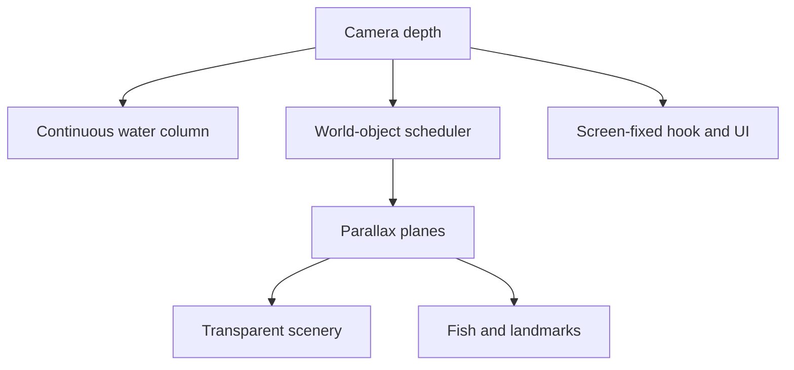

# HOOKED Underwater Scene Architecture

This kit rebuilds the underwater descent as one continuous water column plus transparent, independently placed world objects. It is deliberately **not** a stack of full-screen illustrated panels.

## The rule that prevents visible seams

Only `assets/background/water-column-2560x9600.png` is a full-width opaque image. Every cliff, reef, wreck, vent, landmark, plant, fish and effect is a transparent sprite placed in world space.

Never place a second opaque scene panel over the water column. Never author a foreground asset with a full-width floor, rectangular haze patch, or straight horizontal top/bottom edge. Those shapes reveal the image boundary as soon as the camera moves.



## Coordinate model

Use one vertical world coordinate called `depth`. Increasing depth means travelling downward. The camera owns `cameraDepth`; objects do not move through the world merely because the camera descends.

```ts
screenY = viewportHeight * anchorY + (object.depth - cameraDepth) * parallax;
```

`anchorY` is normally `0.5`, so the camera depth is aligned to the middle of the viewport. A low parallax value makes an object feel distant; a high value makes it pass the camera quickly and feel close.

### Recommended render planes

| Plane | Parallax | Typical content | Treatment |
|---|---:|---|---|
| Water | `0.00–0.02` | Continuous gradient | Fill/cover; no horizontal repeats |
| Far silhouette | `0.03–0.07` | Huge distant cliff shapes | Strong depth fog, low contrast |
| Distant | `0.08–0.16` | Submarine, distant terrain | Cool tint, reduced opacity |
| Distant life | `0.12–0.20` | Tiny fish/whale silhouettes | Slow drift |
| Landmark | `0.22–0.34` | Wreck, shrine, whale fall | One dominant landmark per segment |
| Midground | `0.32–0.48` | Vents, medium rocks, fish | Main readable scene layer |
| Target fish | `0.55–0.75` | Hooked fish | Runtime 3D or animated sprite |
| Foreground | `0.65–0.90` | Reef edges and framing cliffs | Largest motion, soft edge fade |
| Screen | N/A | Hook, line, UI | Screen-fixed, not parallaxed |

The values are starting points, not physical measurements. Tune them while watching a descent at final gameplay speed.

## Responsive composition

Do not keep separate mobile and desktop copies of modular scenery. Use the same transparent sources and change their placement, scale, and crop.

| Rule | Mobile | Desktop |
|---|---:|---:|
| Clear fishing corridor | `34–42%` of viewport width | `28–36%` |
| Edge overscan | `8–15%` | `5–12%` |
| Landmark visible width | `55–90%` | `30–60%` |
| Simultaneous dominant landmarks | 1 | 1, occasionally 2 if separated |

Keep the hook/fish corridor readable. Large cliffs and reef pieces should usually enter from the left or right edge and extend beyond the viewport. Use mirroring sparingly; landmarks with writing, damage, or recognizable asymmetry should not be mirrored.

## Continuous water background

The supplied water column is `2560 × 9600`. Map world depth `0…9600` to its vertical UV/position. When the camera moves below the authored depth, continue with solid `#05080c`; the last 300 px of the source is already flat in that color.

Do not scale the water image separately for each zone. Use one transform for the whole descent so its color progression remains continuous. On viewports wider than the image ratio, crop horizontally or stretch only slightly; never tile vertically above the flat abyss extension.

## Object scheduling, not image-panel scheduling

Divide the world into logical depth segments only to decide **what to spawn**. Do not render each segment as a rectangular visual panel.

Suggested content rhythm for the 9600-unit descent:

| Depth | Zone | Suggested content |
|---:|---|---|
| `0–1600` | Shallows | Sparse reef edges, light particles, common fish |
| `1300–3500` | Blue reef | Reef framing, vegetation, medium fish |
| `3000–5400` | Open deep | Shipwreck or submarine, fewer plants |
| `4900–7300` | Abyss wall | Steep cliffs, vents, whale fall |
| `6800–9000` | Black water | Shrine or treasure, bioluminescent dressing |
| `8500+` | Endless abyss | Sparse objects over flat `#05080c` extension |

Notice the 300–600 unit overlaps. Adjacent themes coexist during transitions so the scene changes gradually instead of switching at one line.

## Asset placement rules

1. Place side geometry partly outside the viewport. The transparent interior edge should face the fishing corridor.
2. Randomize scale only within about ±12%; large random scale changes destroy perceived depth.
3. Give every object a world depth and a plane. Never derive its position directly from the current zone index.
4. Cull objects only after their complete alpha bounds are comfortably outside the viewport.
5. Preload the current segment and the next segment.
6. Use zero or one dominant landmark per segment. Fill gaps with small dressing, particles and fish—not additional monuments.
7. Separate animated emissions. `vent-cluster` remains static while `vent-smoke` drifts, stretches and fades independently.

## Concealing the remaining edges

Transparent art can still look pasted on if its color and sharpness do not match its depth. Apply a common depth treatment after placing the objects:

```ts
const distance = Math.abs(object.depth - cameraDepth);
const fog = clamp(distance / object.fogRange, 0, 1);
const opacity = lerp(1, object.minOpacity ?? 0.35, fog);
const blurPx = lerp(0, object.maxBlurPx ?? 2.5, fog);
```

Tint distant objects toward the local water color, reduce contrast and saturation, and apply a small blur. Near objects keep stronger contrast. Add a subtle full-screen color-grade layer so separately generated art shares the same water.

For side cliffs, a narrow runtime mask can fade the inward transparent edge over roughly `3–8%` of its displayed width. Do not fade the external edge that sits beyond the viewport.

## Particles and effects

Use at least three independent particle planes:

- Far marine snow: tiny, faint, slow; parallax around `0.08`.
- Mid particles: modest size and drift; parallax around `0.30`.
- Near bubbles/debris: occasional large elements; parallax around `0.70`.

Particles should be generated procedurally or pooled from a small texture set. They bridge sparse gaps and provide motion continuity, but they should not be used to hide a bad rectangular seam.

## Hook, line and fish

Keep the hook near a stable screen-space target, normally 38–48% down the viewport. The line is drawn from the surface/rod anchor to the hook every frame. The underwater world scrolls behind it.

The selected fish belongs to the `target` plane until hooked. Once attached, its world-to-screen movement can blend toward the hook's screen-space anchor so the struggle remains readable:

```ts
fishScreen = lerp(worldProjectedPosition, hookScreenPosition, hookBlend);
```

Background fish remain world objects. The fish table is a species source, not a flattened background layer.

## Rendering architecture

Canvas, PixiJS, Phaser or WebGL is preferable once there are many fish and particles. DOM/CSS can work for a prototype, but do not update React state every animation frame. Keep frame state in refs or in the renderer and let React manage menus, game state and lifecycle.

Per frame:

1. Read/interpolate `cameraDepth`.
2. Select visible objects using their depth and maximum display bounds.
3. Sort by plane and explicit `z`.
4. Project world coordinates to screen coordinates.
5. Apply fog, tint, opacity and optional blur.
6. Draw the line/hook and UI after the world.

`src/underwater-scene.ts` contains a starter data model, plane values, projection helper and visibility calculation.

## Asset authoring checklist

- Transparent RGBA PNG or lossless WebP.
- Generous alpha margin around the visible object.
- No full-width floor or rectangular atmosphere.
- No straight horizontal cut at the entry/exit edge.
- Consistent light direction and cel-painted treatment.
- Named anchor point documented in the manifest.
- Smoke, bubbles, glow and moving parts separated when practical.
- Test on cyan, mid-blue, navy and black—not only on a checkerboard.

## Debugging visible seams

If a seam appears, freeze the camera and draw asset bounds in magenta.

- A full-width horizontal bound means the wrong asset structure was used; split it into modular objects.
- A dark rectangle around a transparent sprite means the baked RGB fringe does not match the local water. Premultiply alpha correctly and color-grade the sprite.
- A pop at a zone boundary means the scheduler spawned/despawned too late. Add overlap and wider culling margins.
- A cliff suddenly stops means its alpha silhouette is too short or too straight. Overscan it, overlap a second piece, or mask/fade its tip.
- Objects sliding together means they share a parallax value. Separate their planes.

## Integration order

1. Implement the continuous water column and camera depth.
2. Add the debug grid and depth readout.
3. Add one left cliff and one right cliff on different planes.
4. Add one landmark and verify culling/overlap.
5. Add procedural particles and shared depth fog.
6. Add fish and the screen-fixed line/hook.
7. Add the zone scheduler and randomized dressing last.

This order makes visual errors attributable to one system instead of hiding them inside a fully populated scene.
